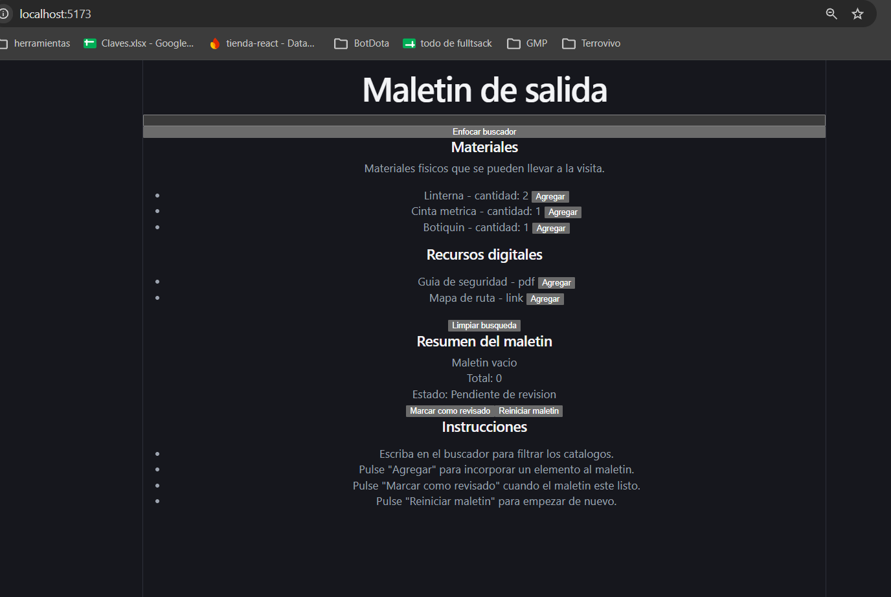
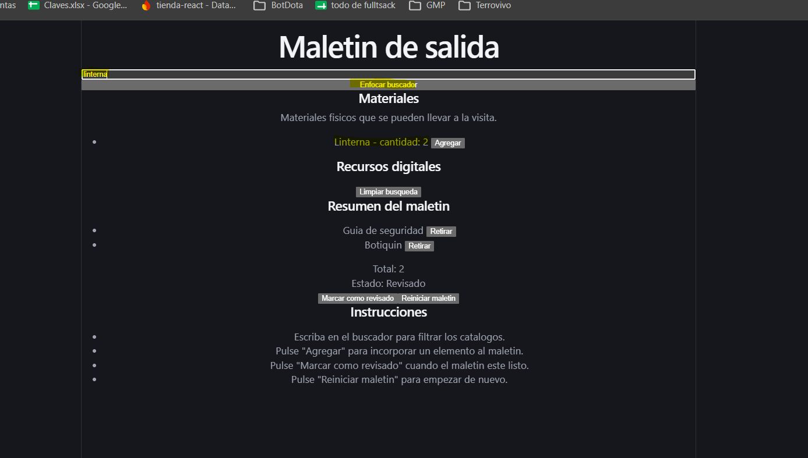
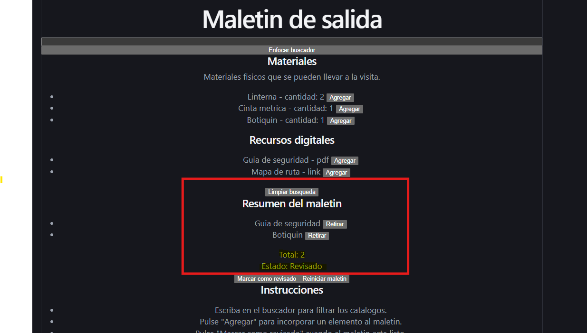

# maletin-salida

## proposito

app en react con typescript para armar un maletin de salida. se buscan elementos en dos catalogos (materiales y recursos digitales), se agregan al maletin, se retiran, se marca como revisado o se reinicia. no usa servidor ni guarda datos.

## requisitos previos

tener node.js 22.12 o mas nuevo y npm.

## comandos

- npm install
- npm run dev (abrir http://localhost:5173)
- npm run build

## datos iniciales

- materiales: m-01 Linterna 2, m-02 Cinta metrica 1, m-03 Botiquin 1
- recursos digitales: r-01 Guia de seguridad pdf, r-02 Mapa de ruta link

## flujo principal

escribir en el buscador, dar agregar en un elemento, ver el resumen del maletin, marcar como revisado, retirar elementos o reiniciar el maletin.

## preguntas

- que responsabilidad tiene useState: guarda el texto del buscador, que es estado temporal de la interfaz.
- que transiciones concentra useReducer: add, remove, markReviewed y reset del maletin.
- que operacion expone la referencia: solo focus, para enfocar el campo desde el boton enfocar buscador.
- como se conserva T en las dos instancias genericas: GenericCatalog se usa con Material y con DigitalResource, y cada getKey, getLabel y onSelect recibe el tipo de su catalogo.
- que contenido cambia mediante composicion: el panel de materiales lleva una descripcion y su catalogo, y el panel digital lleva su catalogo y el boton limpiar busqueda en el footer.

## decisiones tecnicas

- KitItem es una union con source (material o digital), key, name y el item original. sirve para el elemento seleccionado y el guardado en el maletin.
- el mensaje de bloqueo de revisar vacio vive en el estado del reducer, asi KitSummary solo lo muestra.
- el boton enfocar buscador esta en App y usa el handle que expone SearchBox.

## evidencia

P2, P4, P5, P6 y P7 se comprueban con el registro de texto. las capturas son de apoyo.

### npm run build

PS C:\Users\Camus PC\Desktop\universidad\semestre 4\Tarea3-ReactAvanzado\maletin-salida> npm run build

> maletin-salida@0.0.0 build
> tsc -b && vite build

vite v8.3.5 building client environment for production...
✓ 24 modules transformed.
computing gzip size...
dist/index.html                   0.46 kB │ gzip:  0.29 kB
dist/assets/index-D64VDMd1.css    4.10 kB │ gzip:  1.47 kB
dist/assets/index-DCxGd2w9.js   223.41 kB │ gzip: 69.90 kB

✓ built in 121ms

### resultados P1 a P8

- P1 escribir linterna: Sale linterna (2) nada mas, recursos digitales queda vacio
- P2 con mapa, limpiar busqueda: Al escribir mapa, lo veo en recursos digitales "mapa de ruta", luego al darle click a limpiar busqueda me sale todo nuevamente
- P3 enfocar buscador: Di click fuera del buscador y luego en enfocar buscador, el cursor se queda parpadeando dentro del campo de busqueda
- P4 marcar como revisado con el maletin vacio: Con el maletin vacio le di click a marcar como revisado, el estado se queda en pendiente de revision y sale el mensaje "Agregue al menos un elemento antes de revisar."
- P5 agregar linterna dos veces: Le di agregar a linterna dos veces, en el resumen sale linterna una sola vez y el total queda en 1
- P6 con linterna y mapa de ruta, retirar linterna: Agregue linterna y mapa de ruta (total 2), le di retirar a linterna y solo queda mapa de ruta con total 1
- P7 reiniciar maletin: Con elementos en el maletin le di reiniciar maletin, sale maletin vacio, total 0 y el estado vuelve a pendiente de revision
- P8 agregar un material y un recurso digital: Agregue botiquin y guia de seguridad, los dos entran al maletin (total 2), en los catalogos botiquin sigue mostrando su cantidad y guia de seguridad su formato pdf

### capturas

- vista inicial (app recien abierta, maletin vacio y pendiente de revision): 
- busqueda con foco (P1 y P3): 
- maletin revisado (P8 y marcar como revisado): 
